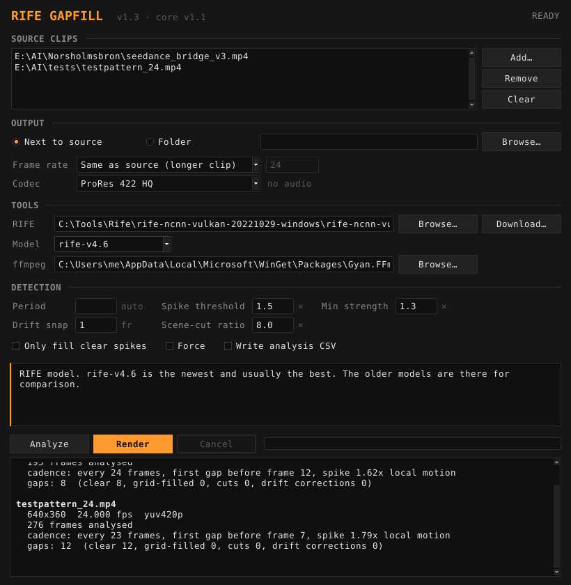

# rife-gapfill

Finds missing and repeated frames in video and rebuilds an even cadence:
repeated frames are dropped and missing frames are filled with
[RIFE](https://github.com/nihui/rife-ncnn-vulkan) interpolation.

It handles:

- **Periodic gaps:** AI-generated video (e.g. Seedance) that drops one frame
  at every generation block, typically every 24 frames.
- **Random drops:** recorders that lose single frames or short runs of frames,
  e.g. an Atomos Ninja in high-frame-rate modes.
- **Repeated frames:** a frame shown twice.
- **A repeat standing in for a missing frame:** the repeat is dropped and the
  real frame interpolated, so the timing comes out right.

Original frames pass through untouched. Output is ProRes at an even frame rate.



## How it works

Every step from one frame to the next gets a length in frame intervals:
**0** is a repeated frame, **1** is normal, and **k** means k-1 frames are
missing. Adding the steps up gives each source frame its true position in
time. The output is then written on an even grid: real frames where they
exist, RIFE frames where they don't.

1. **Measuring** (one decode pass at 480 px):
   - DIS optical flow between each pair of frames. Step speed is the median
     flow inside the area that actually changed, so both camera moves and a
     small moving object on a locked-off shot are measured.
   - Mean frame difference. Where flow can't explain the change (water,
     foliage, AI shimmer) the difference is used instead.
   - Residual after motion compensation. A real frame carries fresh sensor
     noise; a repeat doesn't. This keeps near-still frames from being taken
     for repeats.
2. **Expected step:** the median of the neighbours on both sides within the
   same shot, so steady acceleration is followed. A gap is a step that is a
   whole multiple of the expected one and too long compared with both sides.
   A speed change is only too long on one side.
3. **Periodic prior:** if events fall on a regular grid, borderline steps on
   the grid are accepted too, the grid can be filled through still shots, and
   every grid gap gets the grid's usual frame count.
4. **Confidence:** each event gets a score. Events at or above the
   auto-apply level are ticked; the rest are listed unticked for review.
   Cuts and flashes are recognised and left alone.

### Accuracy on synthetic test clips

The `tests/` folder renders scenes on a perfect timeline and applies known
errors. Each clip covers accelerating pans, a small object on a still
background, a still shot, a cut, a flash and a slow pan.

| Clip | Events | Found | Auto-applied correctly | False auto-applied |
|---|---|---|---|---|
| clean | 0 | – | – | 0 |
| random (ProRes) | 23 | 23 | 23 | 0 |
| random (H.264) | 23 | 23 | 23 | 0 |
| periodic (1 in 24) | 25 | 25 | 25 | 0 |
| smooth handheld | 13 | 12 | 11 | 0 |
| vibration (frame-to-frame jitter) | 13 | 13 | 9 | 1 |

Rendering the random clip restores exactly 600 frames. Every real frame lands
on its true position, and the interpolated frames are within sensor-noise
level of the true frames. Vibration footage is the known weak spot: with
random jitter on every frame, a normal step can look like a gap, so review
the list there.

## Output frame rate

| Mode | Result |
|---|---|
| Same as source | Even cadence at the source rate. Missing frames make the clip longer; dropped repeats make it shorter. |
| Keep original duration | Rate adjusted to keep the duration, e.g. 24 → 25 fps when one frame in 24 was missing |
| Custom | Any rate |

Audio is not carried over.

## Requirements

- Windows for the GUI and RIFE binary. The core script also runs on Linux
  and macOS.
- [ffmpeg + ffprobe](https://ffmpeg.org/). The GUI can download them
  (Gyan's release essentials build), or use `winget install Gyan.FFmpeg`.
  Found automatically next to the exe, in the folder above it, on PATH or in
  the WinGet folder.
- [rife-ncnn-vulkan](https://github.com/nihui/rife-ncnn-vulkan/releases).
  Runs on any GPU through Vulkan. The GUI can download it. A v4 model
  (default `rife-v4.6`) is needed to fill gaps of more than one frame.
- To run from source: Python 3.9+ with `numpy`, `pillow` and
  `opencv-python-headless`.

## GUI

```
pip install numpy pillow opencv-python-headless
python gapfill_gui.py
```

1. **Add** clips and click **Analyze**.
2. Select a clip to review it. The timeline shows the motion of every frame
   step: orange marks are missing frames, blue marks are repeats, grey marks
   are cuts. The list shows each event with timecode, confidence and a note.
   Click the first column to tick or untick an event. Selecting a row shows
   the frames around it.
3. **Render** writes `<name>_fixed_<fps>.mov` with the ticked events applied.

Changing the detection settings and clicking Analyze again reuses the
measurements, so it is instant. Hover over any control to see its help text in
the panel above the buttons. Settings are saved in
`%APPDATA%\RifeGapfill\settings.json`.

### Build a standalone exe

```
pip install pyinstaller numpy pillow opencv-python-headless
pyinstaller --onefile --windowed --name RifeGapfill gapfill_gui.py
```

Add the version to `--name` (e.g. `RifeGapfill-v2.1`) to get a versioned exe.
The exe finds RIFE and ffmpeg next to itself or in the folder above it (so
running from `dist\` works), or use the **Download…** buttons in the GUI.

## Command line

```
python rife_gapfill.py clip.mov --analyze-only
python rife_gapfill.py clip.mov
python rife_gapfill.py clip.mov --out-fps keep --prores 4444
```

| Option | Meaning |
|---|---|
| `--analyze-only` | List events and write a CSV; no render |
| `--min-conf X` | Apply events with confidence ≥ X (default 0.5) |
| `--all` | Apply every missing/repeat event |
| `--gap-ratio X` | Step length that counts as a gap (default 1.5×) |
| `--max-insert N` | Longest gap to fill, in frames (default 3) |
| `--period N` | Force a known period |
| `--no-repeats`, `--no-periodic`, `--no-fill-static` | Switch parts of the detection off |
| `--steps-csv file` | Per-step measurements, for checking against Resolve |
| `--rife`, `--model`, `--ffmpeg`, `--ffprobe` | Tool paths if not found automatically |

## Releases

Releases are built on GitHub by `.github/workflows/release.yml`: the
synthetic test clips are rendered and checked on Linux, the exe is built with
PyInstaller on Windows, and a release is published with the notes from
`docs/releases/<version>.md`, the exe and its SHA-256.

Start it from **Actions > Release > Run workflow** with a version such as
`v2.2`, or by pushing a tag:

```
git tag v2.2
git push origin v2.2
```

Leave the version empty for a test build that is kept as a workflow artifact
and not published.

## Tests

```
cd tests
python make_tests.py clips
python make_handheld.py
python evaluate.py clean random periodic handheld vibration
```

`tests/mockrife` is a flow-based stand-in for rife-ncnn-vulkan, so render
tests run without a GPU.

## License

MIT. RIFE and rife-ncnn-vulkan are separate projects with their own licenses.
